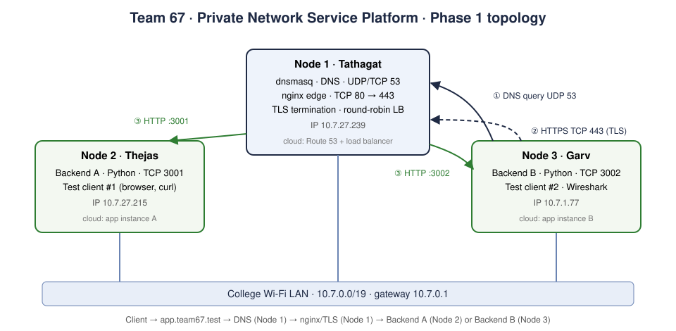

# Team 67 · Architecture document

Private Network Service Platform, Phase 1. Three team members, three Macs, one LAN, no cloud.
A client resolves `app.team67.test` through our own DNS server, connects over HTTPS to our nginx edge,
and is load-balanced across two Python backends.

## 1. Team, machines and roles

The spec's recommended topology has four machine roles (spec §4). We are three people, so two roles share
one Mac, as the spec allows for teams of 2–3 (§3, "Teams of 2–3 may combine machine roles").

| Node | Member | Spec role(s) it covers | Services (port) | Cloud equivalent |
|---|---|---|---|---|
| Node 1 | **Tathagat Harsh** (2401010477) | Mac 1 DNS server + Mac 2 edge | dnsmasq (53/udp+tcp), nginx (80 → 443/tcp), TLS + load balancer, team CA | Route 53 private zone + ALB |
| Node 2 | **MS Thejas** (2401010255) | Mac 3 Backend A + test client | Python backend A (3001/tcp), browser/curl client | EC2 instance A in a target group |
| Node 3 | **Garv Verma** (2401010168) | Mac 4 Backend B + test client | Python backend B (3002/tcp), curl client, Wireshark | EC2 instance B in a target group |

Why this split:
- **DNS and edge together on Node 1.** Both need admin rights (spec §3); one Mac holds all infrastructure, and both clients are other Macs.
- **Two other Macs use our DNS** (spec Task B: "at least two other Macs") = MS Thejas and Garv Verma.
- **Clients are never the edge machine.** A request from Node 1 to itself would stay on the loopback interface and never cross the LAN. From Garv Verma's Mac every DNS, TCP and TLS packet really crosses the Wi-Fi to Node 1, which the Wireshark capture shows (destination MAC = Node 1).
- **Backends on two different Macs**, so stopping Backend A is a real host-level failure and nginx balances across two real IPs.

## 2. Topology and inventory



```
                  one Wi-Fi LAN / subnet (same gateway)
   ┌───────────────────────────┬───────────────────────────┐
 Node 2 · MS Thejas            Node 1 · Tathagat           Node 3 · Garv Verma
 Backend A :3001     ◄─HTTP─ dnsmasq :53          ─HTTP─► Backend B :3002
 client #1 (browser)         nginx :80 → :443 (TLS, LB)    client #2 + Wireshark
        │                      ▲      ▲                        │
        └──── DNS 53/udp ──────┘      └──── HTTPS 443/tcp ─────┘   (both clients)
```

IP and interface inventory, copied from the real outputs in `evidence/A-lan/` (captured 2026-10-05 on the college Wi-Fi,
subnet 10.7.0.0/19; every pair pinged with 0% loss and TTL 64):

| Node | Member | IPv4 | Subnet mask / prefix | Default gateway | Interface | MAC |
|---|---|---|---|---|---|---|
| Node 1 | Tathagat | 10.7.27.239 | 255.255.224.0 / 19 | 10.7.0.1 | en0 (Wi-Fi) | 7e:54:32:73:01:15 |
| Node 2 | MS Thejas | 10.7.27.215 | 255.255.224.0 / 19 | 10.7.0.1 | en0 (Wi-Fi) | 6e:f1:6c:21:19:6a |
| Node 3 | Garv Verma | 10.7.1.77 | 255.255.224.0 / 19 | 10.7.0.1 | en0 (Wi-Fi) | a2:dc:7b:8f:5e:71 |

DNS records (`dns/dnsmasq.conf`): `app.team67.test` and `api.team67.test` → 10.7.27.239 (Node 1), TTL 60 s.
nginx upstream: Backend A 10.7.27.215:3001 (MS Thejas), Backend B 10.7.1.77:3002 (Garv Verma).

## 3. One request, layer by layer

`curl https://app.team67.test/api/status` on Garv Verma's Mac:

1. **Name resolution (DNS, UDP 53).** Garv Verma's Wi-Fi DNS server is Node 1. The system resolver sends
   `A? app.team67.test` from a random high source port to Node 1 port 53. dnsmasq owns the `team67.test` zone
   (`local=/team67.test/`), so it answers from its own record and never forwards it: Node 1's IP, TTL 60.
   Any other name (e.g. google.com) is forwarded upstream, so the clients keep normal internet access.
2. **Link layer.** Node 1 is on the same subnet, so Garv Verma's Mac ARPs for Node 1's IP and sends the frame
   straight to Node 1's MAC address. The gateway's MAC is not used (TTL 64 in ping replies = no router hop).
3. **TCP three-way handshake (TCP 443).** SYN from an ephemeral port → 443, SYN-ACK, ACK. Socket pair:
   (Garv Verma IP, ephemeral port) ↔ (Node 1 IP, 443). Sequence/acknowledgement numbers start here.
4. **TLS handshake.** ClientHello (SNI `app.team67.test`, ALPN offers `h2,http/1.1`) → ServerHello +
   Certificate + ServerKeyExchange + ServerHelloDone → ClientKeyExchange + ChangeCipherSpec + Finished →
   server ChangeCipherSpec + Finished. The client checks the certificate: name matches the SAN, signature chains to
   "Team67 Local Root CA", which Garv Verma's Mac trusts in its System keychain. No `-k` is ever used.
5. **HTTP/2 over TLS.** `GET /api/status` travels as encrypted TLS Application Data. Wireshark sees only
   ciphertext; the headers are visible only on the endpoints (`curl -v`, browser DevTools).
6. **Edge: TLS termination + load balancing.** nginx decrypts, picks the next backend round-robin from the
   `team67_backends` upstream, and opens a separate plain-HTTP TCP connection to MS Thejas:3001 or Garv Verma:3002,
   adding `X-Forwarded-For`, `X-Real-IP`, `X-Forwarded-Proto`. The access log records `upstream=<IP:port>`.
7. **Backend.** The Python backend answers JSON with `X-Backend: A` or `B` and `Cache-Control: no-store`.
   Its log shows `from=<Node 1 IP>`: a backend only ever talks to the edge, never to the client.
8. **Back to the client.** nginx re-encrypts the response in the client's TLS session and sends it as HTTP/2.
9. **Failure handling.** If a backend refuses the connection or times out (5 s; raised from 2 s after college Wi-Fi delay spikes caused false timeouts), nginx retries the same
   request on the other backend (`proxy_next_upstream`) and skips the failed one for 10 s (`max_fails=1 fail_timeout=10s`).

**Why the client never needs the backend IPs:** the client only knows the name. DNS maps the name to the edge,
and only the edge's config lists the backends. Backends can move, be added or fail without any client change.
This is the same separation a cloud load balancer gives.

## 4. Protocol-to-layer mapping

| Protocol | OSI layer | TCP/IP layer | Where in our project | Shown by |
|---|---|---|---|---|
| HTTP/1.1, HTTP/2 (REST, JSON) | 7 Application | Application | Client ↔ nginx (h2 via ALPN), nginx ↔ backend (HTTP/1.0) | `curl -v`, `curl --http1.1/--http2`, DevTools |
| DNS | 7 Application | Application | Clients → dnsmasq on Node 1 | `dig`, `nslookup`, dnsmasq query log, Wireshark `dns` |
| TLS 1.2 / 1.3 | 5–6 Session/Presentation | between Application and Transport | Terminated at nginx | Wireshark `tls.handshake`, `curl -v` |
| TCP | 4 Transport | Transport | 443 (HTTPS), 3001/3002 (backends), DNS fallback | Wireshark SYN/SYN-ACK/ACK, seq/ack |
| UDP | 4 Transport | Transport | 53 (DNS queries) | Wireshark DNS packet ports |
| IPv4 | 3 Network | Internet | Private addresses on one subnet | `ipconfig`, `ping` |
| Ethernet / Wi-Fi (802.11), ARP | 2 Data link (+1 physical) | Link | One Wi-Fi LAN | MAC addresses in Wireshark, `ifconfig` |

HTTP/3 (QUIC over UDP 443) is explanation-only in this project; other apps' QUIC traffic may appear in captures.

## 5. Design decisions

| Decision | Why |
|---|---|
| Ports 443 and 80 (80 only redirects to HTTPS) | Real HTTPS port, no `:8443` in URLs; we need root on Node 1 anyway for DNS port 53. 8443 is used only in the wrong-port failure demo. |
| TLS terminates at nginx; plain HTTP to backends | One certificate on one machine; backends stay simple. In production the backend leg would be a private network or re-encrypted. |
| Own root CA instead of a single self-signed cert | Clients trust the CA once; the server cert can be reissued without touching clients. SAN lists names only, no IPs. |
| `ssl_protocols TLSv1.2 TLSv1.3` | 1.3 by default; the capture uses `curl --tls-max 1.2` because TLS 1.3 encrypts the Certificate message. |
| Round-robin + passive health checks | Simple, visible A/B alternation; open-source nginx has no active health checks. |
| `/api/status` is `no-store`; `/api/cached` is `public, max-age=60` with an ETag | Status must always reach a backend (shows LB); cached shows Task F. Both backends return identical cached content, so the ETag is identical and a 304 works whichever backend answers. |
| Python standard library backend, one file for A and B | No packages to install on teammates' Macs; `BACKEND`/`PORT` env vars select the identity. Binds 0.0.0.0 so the edge can reach it. |
| dnsmasq: `local=/team67.test/`, `no-hosts`, upstream forwarding | Our zone is authoritative and never leaks upstream; everything else still resolves. `.test` is reserved (RFC 6761); `.local` would clash with mDNS. |

## 6. Caching behaviour (Task F)

| Case | What happens | Network traffic |
|---|---|---|
| Fresh cache hit | Within `max-age=60` the browser reuses its stored copy | None (DevTools shows "(disk cache)") |
| Conditional request | After expiry the client sends `If-None-Match: <ETag>`; content unchanged → `304 Not Modified` | Headers only, no body |
| Full request | No stored copy (or content changed) | `200` with full body |

## 7. Single point of failure

Node 1 runs both DNS and the edge, so it is the single point of failure: if Tathagat's Mac sleeps, names stop
resolving and HTTPS stops. Phase 2 removes this with a backup DNS resolver on another Mac (Extension A) and a
standby nginx with DNS-based cutover (Extension E). Backend failure is already tolerated (Task H3).

## 8. Problems found during the build (real troubleshooting, 2026-10-05)

| Symptom | Layer | Cause | Fix | Evidence |
|---|---|---|---|---|
| `zsh: operation not permitted: scripts/rec.sh` on MS Thejas's Mac | OS | macOS quarantine flag on files unzipped from a download | `xattr -dr com.apple.quarantine .` | session notes |
| MS Thejas's `dig app.team67.test` answered by `SERVER: 8.8.8.8`, NXDOMAIN, although Wi-Fi DNS was set to 10.7.27.239 | DNS (client) | Installed VPN network services (Urban VPN, ProtonVPN) forced their own resolvers (8.8.8.8, 10.5.7.1) | Disabled both VPN services for the session; `scutil --dns` then showed 10.7.27.239 | `B-dns/B4-thejas-client-resolver.txt` (3 failed runs, then success) |
| Garv Verma's and MS Thejas's HTTPS requests failed: `SSL certificate problem: unable to get local issuer certificate` while `nc` to 443 succeeded | TLS | Team CA not yet in the client's System keychain | `security add-trusted-cert … rootCA.pem` | `D-loadbalancer/D2-garv-round-robin.txt` (empty first run), `E-tls/E2-*` |
| Some requests showed only Backend A; nginx logged `upstream timed out … 10.7.1.77:3002` with `upstream_status=504, 200` | TCP / Wi-Fi | College Wi-Fi delay spikes (up to ~455 ms) exceeded `proxy_connect_timeout 2s`, so nginx marked B down for 10 s | Raised `proxy_connect_timeout` to 5 s; A/B alternation returned | `logs/nginx-error.log` lines 11:55–12:04 |
| First H2 run still resolved to the correct IP | DNS (server) | dnsmasq was not restarted (a different terminal tab was restarted), so the edited record was never loaded | Restarted the real dnsmasq process (PID changed 35590 → 51083); H2 then failed as intended | `H-failures/H2-garv-wrong-record.txt` (two runs) |
